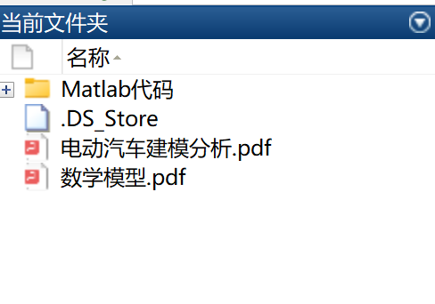
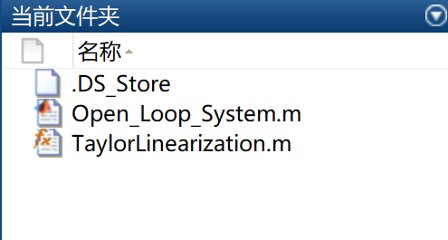

# Electric Vehicle Modeling - Future Trends (Simulink and Matlab Code)

The automotive industry is undergoing a revolution, with an increasing investment in electric devices to replace internal combustion engines in current and future vehicles. Although range anxiety is the main factor hindering widespread adoption globally, automobile manufacturers are placing significant emphasis on driving performance to ensure a smooth transition from gasoline cars to electric ones. Driving performance refers to the smoothness of vehicle operation, and in electric vehicles, low-frequency vibrations from the electric drive system are the source of discomfort. This paper proposes different control strategies to suppress the human perception of low-frequency vibrations during vehicle operation. The work includes dynamic modeling, linearization, system identification, classical control strategies, and advanced control strategies. Simulation results demonstrate the effectiveness of each method and evaluate the controller's performance in suppressing low-frequency vibrations.

## Images

<!-- PAYMENT_BLOCK -->

## Get this dataset

- Payment link (Stripe): [Buy now](https://buy.stripe.com/3cs8yP7sY87d0vu9AB)
- Payment QR code: 

<!-- /PAYMENT_BLOCK -->
